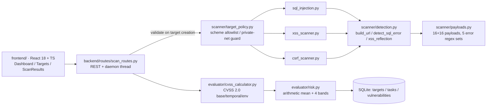

# Web Vulnerability Scanner · Per-parameter payload probing + CVSS 2.0 scoring

**English** | [简体中文](README.md)


> Give it a URL with query parameters. It injects 16 SQL-injection payloads and
> 16 XSS payloads into **every parameter**, decides whether a finding is real by
> matching database error signatures and by checking whether the payload is
> reflected verbatim, then scores each finding with the CVSS 2.0 base / temporal /
> environmental formulas and aggregates them into one task-level risk score.
> Flask + SQLite backend, React dashboard.

---

## ⚠️ Authorized use only

This is a teaching / research scanner, **not** a tool for attacking other
people's sites. Scanning a target without written permission is illegal in most
jurisdictions. The repo ships `scripts/vulnerable_app.py`, a deliberately
vulnerable lab app — point every demo and smoke test at it.

The defaults are relaxed on purpose (localhost scanning allowed, TLS verification
off, permissive CORS) so the lab works out of the box. Every one of those
defaults is listed in the limitations table below; do not ship them to the
public internet.

---

## Why this shape

| Approach | How it works | Finds | Misses | Trade-off here |
| --- | --- | --- | --- | --- |
| SAST (Semgrep/CodeQL) | reads source, tracks tainted data | injection points before deploy | runtime concatenation, third-party code | we never read source, only HTTP responses |
| **Black-box scanning (this repo)** | sends payloads, inspects responses | real reflected / error-based bugs on a live target | business-logic bugs, authenticated deep links, stored XSS | single-URL scan, no crawler, no session |
| Commercial DAST | crawler + plugin heuristics | much wider coverage | still needs human triage | only 3 detectors, all rules readable |

The real point of the project is **explainability of a verdict and of a score**:

1. *Readable rules* — "SQL injection" means one of the five regexes in
   `payloads.SQL_ERRORS` matched the response body. You can read, change and
   unit-test each rule (`tests/test_detection.py`).
2. *Fixed scoring* — CVSS 2.0 formulas plus one preset profile per vulnerability
   type (`evaluator/cvss_calculator.py`). Same input, same score, asserted in tests.
3. *Pure logic split from IO* — `payloads.py` / `detection.py` / `target_policy.py`
   have zero third-party dependencies, so detection rules are verified fully
   offline (no lab, no network).

---

## Architecture



`POST /api/scan/start` creates a `pending` task, spawns a daemon thread, probes
reachability (`classify_target_status`), runs the selected scanners, scores and
persists each finding, then aggregates the task score and marks it `completed`.
On startup, leftover `running` tasks are marked `failed`.

---

## Core modules

| Module | File | Responsibility | Implementation details |
| --- | --- | --- | --- |
| SQL injection | `backend/scanner/sql_injection.py` | per-parameter probing | **Error-based**: injects 16 payloads per query parameter, matches 5 database error regexes against the body; on hit records `high` and stops that parameter; otherwise a length delta **> 100 bytes** is recorded as `SQL注入（疑似）` (`medium`). No real boolean/time-blind logic |
| XSS | `backend/scanner/xss_scanner.py` | reflected XSS | all 16 payloads on URL params; BeautifulSoup walks `<form>`, skips `submit`/`button`/`hidden`, sends only the **first 5** payloads per writable field (GET → query, POST → body) |
| CSRF | `backend/scanner/csrf_scanner.py` | missing protection | POST forms only: a hidden field whose name **contains** a token name and has a non-empty value counts as protected, other inputs need an **exact** name match; severity raised to `high` when the action or a field name hits one of 18 sensitive keywords, or `type=password` exists. Also flags `Set-Cookie` without `SameSite` |
| Signature data | `backend/scanner/payloads.py` | pure data | 16 SQLi (incl. `AND '1'='1'` / `AND '1'='2'` pair), 16 XSS, 5 DB error regex sets, 12 token field names, 18 sensitive keywords, length threshold 100 |
| Detection functions | `backend/scanner/detection.py` | IO-free decision layer | `build_url()` uses `urlencode` (`'` → `%27`, space → `+`); `detect_sql_error()` searches MySQL → PostgreSQL → MSSQL → Oracle → SQLite with `IGNORECASE`; `xss_reflection_detected()` has two evidence levels; `has_csrf_token()` / `is_sensitive_form()` take plain dicts, no bs4 |
| Target policy | `backend/scanner/target_policy.py` | scan boundary | scheme allowlist `{http, https}`; `ipaddress`-based loopback/private/link-local/reserved checks; cloud metadata addresses blocked explicitly; host allowlist supports `*.example.com`; `classify_target_status()` maps 200/403/404/5xx/other to ok/warn/error |
| CVSS scoring | `backend/evaluator/cvss_calculator.py` | three metric groups | CVSS 2.0 formulas, 5 per-type profiles, environmental layer fixed at `CDP=0.3`, `TD=0.75` |
| Risk aggregation | `backend/evaluator/risk.py` | task risk | `risk_score = round(mean(base_scores), 1)`; level bands 9.0/7.0/4.0; `(0.0, 'low')` when clean |
| Scan API | `backend/routes/scan_routes.py` | REST + background job | 9 endpoints, reachability pre-check, persistence, batch delete by scope/limit/target |
| Config | `backend/settings.py` | env vars | 10 `SCANNER_*` / `DATABASE_URL` settings with fallbacks; `tolerate_console_encoding()` fixes `print('✓')` crashes on Windows GBK consoles |
| Frontend | `frontend/src/pages/*.tsx` | dashboards | stat cards + Recharts severity pie + recent scans; target CRUD; vulnerability cards with evidence and remediation |

### Scoring formulas (as implemented)

```python
Impact         = 10.41 * (1 - (1-C) * (1-I) * (1-A))
Exploitability = 20 * AV * AC * Au
base_score     = round(((0.6*Impact) + (0.4*Exploitability) - 1.5) * f(Impact), 1)  # f = 0 if Impact==0 else 1.176
temporal       = round(base_score * E * RL * RC, 1)
environmental  = round((temporal + (10 - temporal) * 0.3) * 0.75, 1)
risk_level     = critical(>=9.0) | high(>=7.0) | medium(>=4.0) | low
```

Measured per-type scores (asserted by the test suite):

| Vulnerability type | base | temporal | environmental | severity | CVSS vector |
| --- | --- | --- | --- | --- | --- |
| SQL injection | **9.7** | 8.8 | 6.9 | critical | `AV:N/AC:L/Au:N/C:C/I:C/A:P` |
| SQL injection (suspected) | 5.8 | 4.7 | 4.7 | medium | `AV:N/AC:M/Au:N/C:P/I:P/A:N` |
| XSS | 5.8 | 5.2 | 5.0 | medium | `AV:N/AC:M/Au:N/C:P/I:P/A:N` |
| CSRF | 6.8 | 6.1 | 5.5 | medium | `AV:N/AC:M/Au:N/C:P/I:P/A:P` |
| Weak CSRF protection | 4.3 | 3.7 | 4.2 | medium | `AV:N/AC:M/Au:N/C:N/I:P/A:N` |

Two counter-intuitive consequences: XSS is labelled `severity='high'` inside the
scanner but persisted as `medium` (CVSS 5.8 wins); and the task score is a plain
arithmetic mean, so a 9.7 SQL injection plus a 4.3 cookie issue becomes 7.0.

---

## Quick start

```bash
python -m venv .venv && source .venv/bin/activate    # Windows: .venv\Scripts\activate
pip install -r requirements.txt
cp .env.example .env                                  # change SCANNER_SECRET_KEY at least
cd backend && python app.py                           # http://127.0.0.1:5000
```

The backend must be started **from `backend/`** — it uses flat imports such as
`from models import db`, not a package-relative layout.

```bash
cd frontend
npm ci
npm run dev        # http://localhost:3000, /api proxied to 127.0.0.1:5000
```

Smoke-test against the bundled lab:

```bash
python scripts/vulnerable_app.py     # terminal 1, port 8080 (falls back to 8888)
python scripts/smoke_scan.py         # terminal 2
# different port: SMOKE_TARGET=http://127.0.0.1:8888 python scripts/smoke_scan.py
```

Observed output against that lab: SQLi 1 finding (SQLite, `' OR '1'='1`),
XSS 2 findings (same reflection counted once via URL param and once via form
field — known duplicate), CSRF 1 finding (POST form without token, sensitive → high).

---

## Tests

```bash
python -m unittest discover -s tests -t .   # 104 cases, no third-party deps needed
python -m pytest -q                         # if pytest is installed
```

| Layer | Cases | Requires | Covers |
| --- | --- | --- | --- |
| Pure logic | 94 | stdlib only | CVSS formulas and bands, task-score aggregation, 5 error signatures (negatives + precedence), two-level XSS reflection, payload percent-encoding, scheme allowlist, private/metadata address detection, `*.` host allowlist, status-code classification, CSRF token matching (two passes), sensitive-form detection, env parsing and fallbacks |
| Flask API | 10 | flask + flask-sqlalchemy + requests | `/api/health`, target creation (`file://` rejected, empty body must not 500), target listing, statistics shape, `start` returns 404 for unknown target, `SCANNER_BLOCK_PRIVATE_TARGETS=true` rejects localhost |

The Flask layer is wrapped in `skipUnless(FLASK_AVAILABLE)`: **on a machine with
only Python, those 10 skip and the other 94 must stay green**. CI runs both
modes — full install, then uninstall-deps and re-run.

`scripts/smoke_scan.py` is not a unit test: it really sends HTTP requests.

The frontend is outside the unittest scope; it is verified with
`npx tsc --noEmit` (type check) and `npm run build` (bundle), both passing today.

---

## Limitations

### Security-relevant defaults

| Item | Default | Risk | How to tighten |
| --- | --- | --- | --- |
| Target restriction | scheme allowlist `{http,https}`, **any host incl. private nets** | SSRF: anyone reaching the API can make the server fetch intranet / cloud-metadata URLs. `SCANNER_BLOCK_PRIVATE_TARGETS` defaults to **false** so the local lab works | `SCANNER_BLOCK_PRIVATE_TARGETS=true`, plus `SCANNER_ALLOWED_TARGET_HOSTS` |
| API auth | **none** | anyone can create targets, start scans, delete records | keep it on localhost / put an authenticating proxy in front |
| Rate limiting | **none** | a single-parameter `all` scan already costs dozens of requests (SQLi baseline + 16 payloads, 16 XSS, 1 CSRF) and grows linearly with parameter count; unbounded concurrent daemon threads | add throttling at the gateway |
| CORS | `*` | any site can call these endpoints cross-origin | `SCANNER_CORS_ORIGINS=https://your-ui` |
| TLS verification | **off** (`verify=False`) | MITM can read or tamper with scan traffic and thus forge findings | `SCANNER_TLS_VERIFY=true` (breaks self-signed labs) |
| Bind address | `127.0.0.1:5000`, debug off | not exposed to LAN by default (the original code used `0.0.0.0` + `debug=True`) | set `SCANNER_HOST` explicitly, after fixing the rows above |
| SSRF depth | scheme + literal hostname only | **no DNS resolution**, so `127.0.0.1.nip.io` bypasses the guard; 302 redirects to intranet are not intercepted | real protection must validate the resolved IP at connect time |

### Detection boundaries

- **SQL injection is error-based only.** Blind probing is the "length delta > 100
  bytes" heuristic, which false-positives on any page with timestamps or random
  content. The `AND '1'='1'` / `AND '1'='2'` pair is sent but **no differential
  comparison is implemented**. No time-based blind injection.
- **XSS is reflected only.** Stored XSS needs inject → find echo page → re-request;
  this tool only requests the injected URL. Form probing covers self-reflection only.
- **XSS weak evidence false-positives**: sharing a token like `onload=` between
  payload and response counts as a hit even when angle brackets were escaped.
- **CSRF checks token presence, never token validity.** Hidden fields match by
  **substring**, so a plain `access_token` field counts as protection (false
  negative). No Referer / Origin validation.
- **Duplicate findings**: the same reflection is reported once via URL parameter
  and once via form field (observed on the bundled lab).
- **No crawler, no session**: single URL, no cookies/headers, no JS rendering.
- **Only GET query strings and form bodies** — no JSON request bodies, no path
  parameters (`/user/1`), no header injection.

### Engineering debt

- Task score is an arithmetic mean (dilutes a single critical finding), and
  `risk_level` uses the **unrounded** mean, so "9.0 displayed as high" can happen.
- Scanner-internal `high` vs CVSS-derived `medium` for XSS — two severity notions coexist.
- **No task queue**: one daemon thread per scan; process exit loses running tasks.
- `ScanTask.to_dict()` computes `len(self.vulnerabilities)`, an N+1 query.
- **No migrations** (SQLite + `db.create_all()`).
- **Windows GBK consoles**: emoji `print()` calls crash with `UnicodeEncodeError`
  (the original lab app crashed on startup); mitigated via `errors='replace'`.
- **Frontend has no unit tests and is not built in CI**: `npx tsc --noEmit` and
  `vite build` both pass locally (single JS chunk ~585 KB / gzip 174 KB, above
  Vite's 500 KB warning, no code splitting); CI only runs the backend tests.
- Dependency versions are pinned to the originals (Vite 5 / React 18.2 / TS 5.2); no upgrade guarantee.

### Claims from the original design docs that are **not** in the code

"Time-based blind injection", "Referer validation", "sensitive information
disclosure detection", "security misconfiguration detection", "caching",
"pagination", and the database indexes described in `数据库设计.md` — none of
them exist in this codebase (`models/database.py` has no `index=True` anywhere).
This README describes actual behaviour only.

---

## Roadmap

- [ ] Boolean-blind SQL injection via response-similarity diffing
- [ ] Time-based blind injection (`SLEEP()` / `pg_sleep()` with repeated sampling)
- [ ] Stored XSS (second request to the echo page)
- [ ] Crawler + authenticated sessions (cookie/header/CSRF-token replay)
- [ ] Finding de-duplication (same location + type → one record)
- [ ] Real task queue with cancel and concurrency limits
- [ ] Rate limiting and API authentication
- [ ] Replace mean-based task score with max / weighted aggregation
- [ ] Frontend vitest suite + `npm run build` in CI
- [ ] Report export (JSON / CSV / Markdown)

## License

[MIT](LICENSE) © 2026 DOUFUQAQ
