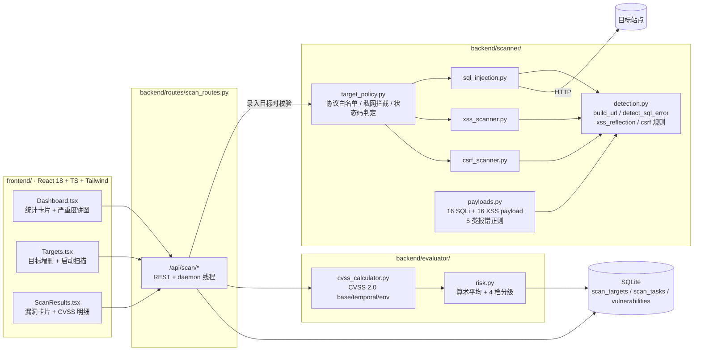

# Web 应用漏洞检测与风险评估平台 · 逐参数打 payload + CVSS 2.0 量化

[English](README.en.md) | **简体中文**


> 输入一个带查询参数的 URL，它把 16 条 SQLi payload 和 16 条 XSS payload
> **逐个参数**打进去，用「数据库报错正则」和「payload 是否原样回显」判断有没有洞；
> 再对每个洞按 CVSS 2.0 公式算出 base / temporal / environmental 三层分数，
> 汇总成一条任务级风险分。后端 Flask + SQLite，前端 React 仪表板。
>
> **只允许对自己拥有或已获书面授权的目标使用。**

---

## ⚠️ 合法使用

这是一个**教学/研究性质**的漏洞扫描器，不是拿来打别人网站的。

- 扫描未授权目标在多数司法辖区属于违法行为（中国《网络安全法》第 27 条、
  美国 CFAA 等），本仓库不提供任何形式的授权。
- 仓库自带 `scripts/vulnerable_app.py` 这个**故意留洞**的靶场，
  所有演示、冒烟测试都请对着它跑。
- 默认配置为了跑本地靶场而刻意放宽了安全边界（允许扫 localhost、
  不校验证书、CORS 全放开）。这些默认值在 README 末尾逐条列了出来，
  请不要带着默认配置上公网。

---

## 为什么这么做

同类工具大致分三档，本项目的定位很清楚——**第二档**：

| 方案 | 原理 | 能发现什么 | 漏什么 | 本项目的取舍 |
| --- | --- | --- | --- | --- |
| 源码审计（SAST，Semgrep/CodeQL） | 读代码找危险的数据流 | 未上线代码里的注入点，覆盖全 | 运行时拼接、第三方组件里的洞 | 不读源码，只看 HTTP 响应 |
| **黑盒扫描（本项目）** | 发 payload 看响应特征 | 线上真实存在的反射/报错型洞 | 业务逻辑洞、需登录态的深链、存储型 XSS | 单 URL 扫描，不做爬虫不做登录 |
| 商业 DAST（Acunetix/AppScan） | 爬虫 + 插件 + 启发式 + 被动流量 | 覆盖广，含 JS 渲染、文件包含、SSRF | 依然漏逻辑洞，误报仍需人工确认 | 只有 3 个检测器，规则全公开可读 |
| 手工渗透 | 人 | 一切 | 慢、贵、不可复现 | 本项目结果适合当人工验证的**线索清单** |

选择"小、可读、口径固定"而不是"大而全"，是因为这个项目想解决的问题是
**"一条漏洞结论是怎么得出来的、那个分数是怎么算出来的"**：

1. **判定规则可读**：什么算 SQL 注入？就是 `SQL_ERRORS` 里那 5 组正则命中了
   响应正文。你可以逐条读、逐条改、逐条写测试（`tests/test_detection.py`）。
2. **评分口径固定**：不是拍脑袋分高/中/低，而是 CVSS 2.0 的三段公式 +
   每个漏洞类型一组预设 profile（`evaluator/cvss_calculator.py`）。
   同样的输入永远得到同样的分数，测试里锁了真值。
3. **纯逻辑与 IO 分离**：`payloads.py` / `detection.py` / `target_policy.py` 零第三方
   依赖，所以"检测规则"这件事可以完全离线验证，不需要起靶场、不需要联网。

---

## 架构



一次扫描的时序：`POST /api/scan/start` 建一条 `pending` 任务 → 起
`threading.Thread(daemon=True)` → 线程里先探测目标可达性（`classify_target_status`）
→ 依次跑被选中的扫描器 → 每条漏洞算 CVSS 分并落库 → 用算术平均得到任务分 → 任务置
`completed`。进程重启时 `app.py` 会把残留的 `running` 任务标记成 `failed`。

---

## 核心模块

| 模块 | 文件 | 职责 | 关键实现（真实细节） |
| --- | --- | --- | --- |
| SQL 注入检测 | `backend/scanner/sql_injection.py` | 逐参数探测注入 | **报错型为主**：对 URL 每个查询参数注入 16 条 payload，用 5 类数据库报错正则匹配响应正文，命中即记 `high` 并停止该参数；未命中但响应长度与基准相差 **> 100 字节**的记一条 `SQL注入（疑似）`（`medium`）。**不做**布尔盲注/时间盲注的真实判定 |
| XSS 检测 | `backend/scanner/xss_scanner.py` | 反射型检测 | URL 参数打满 16 条 payload；再用 BeautifulSoup 解析页面表单，跳过 `submit` / `button` / `hidden`，每个可写字段只打**前 5 条**（`FORM_PAYLOAD_LIMIT`），GET 走 query、POST 走 body |
| CSRF 检测 | `backend/scanner/csrf_scanner.py` | 防护缺失检测 | 只检查 `method=POST` 的表单：隐藏域字段名**含**令牌名（子串）且 `value` 非空即视为已防护，其余 input 需**全等**匹配；action 或字段名命中 18 个敏感词、或存在 `type=password` 时严重度抬到 `high`。另外检查 `Set-Cookie` 是否缺 `SameSite` |
| 特征库 | `backend/scanner/payloads.py` | 纯数据 | 16 条 SQLi（含 `AND '1'='1'` / `AND '1'='2'` 对照组）、16 条 XSS、5 类数据库报错正则、12 个令牌字段名、18 个敏感词、长度差阈值 100 |
| 检测纯函数 | `backend/scanner/detection.py` | 无 IO 的判定层 | `build_url()` 用 `urlencode` 拼 query（引号→`%27`、空格→`+`）；`detect_sql_error()` 按 MySQL→PG→MSSQL→Oracle→SQLite 顺序 `re.search(..., IGNORECASE)`；`xss_reflection_detected()` 两级判据；`has_csrf_token()` / `is_sensitive_form()` 接收普通 dict，不依赖 bs4 |
| 目标策略 | `backend/scanner/target_policy.py` | 扫描边界 | 协议白名单 `{http, https}`；`ipaddress` 判 loopback/private/link-local/reserved/unspecified/multicast；云元数据地址单独硬拦；主机白名单支持 `*.example.com`；`classify_target_status()` 把 200/403/404/5xx/其它翻成 ok/warn/error |
| CVSS 评分 | `backend/evaluator/cvss_calculator.py` | 三层评分 | CVSS 2.0 公式（见下节），5 个漏洞类型预设 profile（AV/AC/Au/C/I/A + E/RL/RC），环境层固定 `CDP=0.3`、`TD=0.75` |
| 风险聚合 | `backend/evaluator/risk.py` | 任务级风险 | `risk_score = round(mean(base_scores), 1)`，`risk_level` 按 9.0 / 7.0 / 4.0 三档；无漏洞时 `(0.0, 'low')` |
| 扫描 API | `backend/routes/scan_routes.py` | REST + 后台任务 | 9 个端点；目标可达性预检（超时/连接失败直接判任务失败）；漏洞落库；`clear` 支持按 scope/limit/target_id 批删 |
| 配置 | `backend/settings.py` | 环境变量 | 10 个 `SCANNER_*` / `DATABASE_URL` 配置项，非法值回退默认值；`tolerate_console_encoding()` 修 Windows GBK 控制台下 `print('✓')` 崩溃 |
| 前端 | `frontend/src/pages/*.tsx` | 可视化 | Dashboard（4 张统计卡 + Recharts 严重度饼图 + 最近 5 条扫描）、Targets（增删 + 一键扫描）、ScanResults（按严重度分组的漏洞卡片，展开看证据与修复建议） |

### 风险评分公式（实际代码，不是文档抄来的）

```python
Impact         = 10.41 * (1 - (1-C) * (1-I) * (1-A))
Exploitability = 20 * AV * AC * Au
base_score     = round(((0.6*Impact) + (0.4*Exploitability) - 1.5) * f(Impact), 1)  # f = 0 if Impact==0 else 1.176
temporal       = round(base_score * E * RL * RC, 1)
environmental  = round((temporal + (10 - temporal) * 0.3) * 0.75, 1)
risk_level     = critical(>=9.0) | high(>=7.0) | medium(>=4.0) | low
```

等式里的权重系数取自 CVSS 2.0 规范；`AV/AC/Au` 与 `C/I/A` 是枚举值
（如 `NETWORK=1.0`、`LOW=0.71`、`NONE=0.704`、`COMPLETE=0.660`、`PARTIAL=0.275`）。
`cvss_vector` 字符串是用**枚举成员名首字母**拼出来的，所以能拼出规范的
`AV:N/AC:L/Au:N/C:C/I:C/A:P`——但这也意味着改枚举名会静默改坏向量，
`tests/test_cvss.py` 里专门锁了这条隐含约定。

**五类漏洞的实测分值**（跑 `python -m unittest discover -s tests -t .` 会校验这些数）：

| 漏洞类型 | base | temporal | environmental | severity | CVSS 向量 |
| --- | --- | --- | --- | --- | --- |
| SQL 注入 | **9.7** | 8.8 | 6.9 | critical | `AV:N/AC:L/Au:N/C:C/I:C/A:P` |
| SQL 注入（疑似） | 5.8 | 4.7 | 4.7 | medium | `AV:N/AC:M/Au:N/C:P/I:P/A:N` |
| XSS（跨站脚本） | 5.8 | 5.2 | 5.0 | medium | `AV:N/AC:M/Au:N/C:P/I:P/A:N` |
| CSRF（跨站请求伪造） | 6.8 | 6.1 | 5.5 | medium | `AV:N/AC:M/Au:N/C:P/I:P/A:P` |
| CSRF 防护不足 | 4.3 | 3.7 | 4.2 | medium | `AV:N/AC:M/Au:N/C:N/I:P/A:N` |

注意两个反直觉的结果，都和"评分口径"有关：

* XSS 在扫描器字典里写的是 `severity='high'`，但落库用的是 CVSS 分级，
  5.8 落在 `medium` 区间——**最终显示 medium**。两个 severity 并存是历史包袱。
* 任务风险分是**算术平均**。一条 9.7 的 SQL 注入 + 一条 4.3 的 Cookie 配置问题
  → 任务分 7.0（high），单看分数会低估那条注入。

---

## 快速开始

### 后端

```bash
python -m venv .venv && source .venv/bin/activate    # Windows: .venv\Scripts\activate
pip install -r requirements.txt

cp .env.example .env          # 按需改，至少换掉 SCANNER_SECRET_KEY
cd backend && python app.py   # 默认 http://127.0.0.1:5000
```

`backend/app.py` 会读 `backend/../.env`（有 python-dotenv 时）与 `os.environ`。
**注意必须在 `backend/` 目录下启动**——代码用的是 `from models import db`
这种同级绝对导入，不是包内相对导入。

### 前端

```bash
cd frontend
npm ci            # 或 npm install
npm run dev       # http://localhost:3000，/api 已代理到 127.0.0.1:5000
```

代理配置在 `frontend/vite.config.ts`。后端换了端口记得同步改。

### 用自带靶场跑通一遍

```bash
# 终端 1：起一个故意留洞的靶场（需要 flask），默认 8080，占用则自动换 8888
python scripts/vulnerable_app.py

# 终端 2：把三个扫描器怼上去，人工看输出
python scripts/smoke_scan.py
# 端口换了就：SMOKE_TARGET=http://127.0.0.1:8888 python scripts/smoke_scan.py
```

对着这个靶场实测的输出（`smoke_scan.py` 的真实形态）：

```
SQLInjectionScanner @ http://127.0.0.1:8080/user?id=1      -> 1 条  (SQLite / ' OR '1'='1)
XSSScanner          @ http://127.0.0.1:8080/search?q=test   -> 2 条  (q 参数反射 + q 表单字段)
CSRFScanner         @ http://127.0.0.1:8080/change_password -> 1 条  (POST 表单无令牌，敏感 -> high)
```

XSS 报 2 条是因为同一个反射点被 URL 参数和表单字段各打中一次——重复计数是
已知问题，见下方局限。

---

## 项目结构

```
web-vuln-scanner/
├── backend/
│   ├── app.py                     # Flask 工厂 + 残留任务清理 + 启动入口
│   ├── settings.py                # 12 个环境变量集中解析（含 console 兜底）
│   ├── models/
│   │   ├── __init__.py
│   │   └── database.py            # ScanTarget / ScanTask / Vulnerability
│   ├── routes/
│   │   ├── __init__.py
│   │   └── scan_routes.py         # 10 个 API + 后台扫描线程
│   ├── scanner/
│   │   ├── __init__.py            # 懒加载（纯逻辑模块不需要 requests）
│   │   ├── vulnerability_base.py  # 抽象基类 + requests.Session（禁用重试）
│   │   ├── payloads.py            # 纯数据：payload / 正则 / 阈值
│   │   ├── detection.py           # 纯函数：URL 拼装 / 报错匹配 / 反射判定 / CSRF 规则
│   │   ├── target_policy.py       # 纯函数：协议白名单 / 私网拦截 / 状态码判定
│   │   ├── sql_injection.py
│   │   ├── xss_scanner.py
│   │   └── csrf_scanner.py
│   └── evaluator/
│       ├── __init__.py
│       ├── cvss_calculator.py     # CVSS 2.0 三层公式 + 5 个 profile
│       └── risk.py                # 任务级算术平均聚合
├── frontend/
│   ├── src/
│   │   ├── App.tsx / main.tsx / index.css
│   │   ├── components/Layout.tsx
│   │   ├── lib/api.ts             # axios 封装 + TS 类型
│   │   ├── lib/utils.ts
│   │   └── pages/{Dashboard,Targets,ScanResults}.tsx
│   ├── package.json / package-lock.json
│   ├── vite.config.ts / tsconfig.json / tsconfig.node.json
│   ├── tailwind.config.js / postcss.config.js
│   └── index.html
├── scripts/
│   ├── vulnerable_app.py          # 故意留洞的靶场（仅测试用）
│   └── smoke_scan.py              # 对靶场跑一遍扫描器，看输出
├── docs/
│   └── api.md                     # 接口清单与字段说明
├── tests/
│   ├── test_cvss.py               # 评分公式、分级阈值、聚合口径
│   ├── test_detection.py          # 报错特征、反射判定、URL 拼装、长度异常
│   ├── test_target_policy.py      # 协议白名单、私网拦截、主机白名单、状态码
│   ├── test_csrf_rules.py         # 令牌识别、敏感表单识别
│   ├── test_settings.py           # 默认值、环境变量覆盖、非法值回退
│   └── test_api.py                # Flask 接口冒烟（缺 flask 时自动 skip）
├── conftest.py                    # 把 backend/ 与仓库根加进 sys.path
├── requirements.txt
├── requirements-dev.txt
├── .env.example
└── .github/workflows/ci.yml
```

---

## 测试

```bash
python -m unittest discover -s tests -t .    # 104 个用例，零第三方依赖也能跑
python -m pytest -q                          # 装了 pytest 也可以
```

**104 个用例**，分两层：

| 层 | 用例数 | 依赖 | 覆盖 |
| --- | --- | --- | --- |
| 纯逻辑 | 94 | 仅标准库 | CVSS 公式与分级阈值、任务分聚合、5 类报错特征（含负样本与优先级）、XSS 两级反射判据、payload 的百分号编码、协议白名单、私网/元数据地址识别、主机白名单 `*.` 匹配、状态码判定、CSRF 令牌两轮匹配、敏感表单识别、环境变量解析与回退 |
| Flask 接口 | 10 | flask + flask-sqlalchemy + requests | `/api/health`、目标创建（含 `file://` 被拒、空 body 不 500）、目标列表、统计字段、`start` 对不存在目标返回 404、`SCANNER_BLOCK_PRIVATE_TARGETS=true` 时 localhost 被拒 |

第二层用 `skipUnless(FLASK_AVAILABLE)` 兜住：**机器上只有 python 时，这 10 个会自动
skip，剩下 94 个必须全绿**。CI 里两条都跑——先装依赖跑全量，再卸掉依赖跑一遍子集，
确保"无 flask 也能绿"这件事不会腐化。

`scripts/smoke_scan.py` 不是单元测试：它真的发 HTTP 请求，需要先起靶场，所以不进
`tests/`，也不在 CI 里跑。

前端不在 unittest 范围内：用 `npx tsc --noEmit`（类型检查）和 `npm run build`
（打包）验证，当前两者都通过。

---

## 已知局限 / 已知问题

这一节比上面所有内容都重要。以下每一条都是读代码或实测得出的事实，不是"自谦"。

### 安全相关的默认行为（部署前必读）

| 项目 | 默认值 | 风险 | 怎么收紧 |
| --- | --- | --- | --- |
| 目标 URL 限制 | 协议白名单 `{http,https}`，**允许任意主机含私网** | 任何能调 API 的人都能让服务器去请求内网/云元数据地址（SSRF）。虽然有 `target_policy.py`，但 `SCANNER_BLOCK_PRIVATE_TARGETS` **默认 false**（否则本地靶场扫不了） | `SCANNER_BLOCK_PRIVATE_TARGETS=true`；再用 `SCANNER_ALLOWED_TARGET_HOSTS` 收窄主机 |
| API 鉴权 | **完全没有** | 谁都能建目标、起扫描、删记录 | 放到内网 / 前面挂一层带认证的反向代理 |
| 速率限制 | **没有** | 一次 `all` 扫描光在单参数页面上就要几十个请求（SQLi 1 次基准 + 16 条 payload、XSS 16 条、CSRF 1 次），且按参数数量线性放大，且可无限次起任务（每次一个 daemon 线程） | 网关层限流；或自己加令牌桶 |
| CORS | `*`（`flask_cors` 全放开） | 任意站点可跨域调这些接口 | `SCANNER_CORS_ORIGINS=https://your-ui` |
| TLS 校验 | **关闭**（`verify=False`，`SCANNER_TLS_VERIFY` 可开） | 扫描流量可被中间人读取/篡改；对"扫描器看到的响应"做手脚可以伪造结论 | `SCANNER_TLS_VERIFY=true`（代价是扫不了自签站点） |
| 监听地址 | `127.0.0.1:5000`，debug 关闭 | 默认不对局域网开放（这是相对原实现改过的地方，原实现是 `0.0.0.0` + `debug=True`） | 要对外就显式设 `SCANNER_HOST`，并先处理上面几条 |
| SSRF 防护深度 | 只校验 scheme / 主机名字面量 | **不做 DNS 解析**，所以 `127.0.0.1.nip.io` 这类指向内网的域名能绕过；302 跳转到内网也不会被拦 | 真正的防护要在建连层校验解析后的 IP |

### 检测能力的边界

- **SQL 注入只做报错型**。盲注靠"响应长度差 > 100 字节"猜，这个启发式误报极高
  （页面带时间戳/随机数就会触发），而且 `AND '1'='1'` / `AND '1'='2'` 这对对照
  payload 只是打进去了，**没有配套的真假响应差分逻辑**。没有时间盲注。
- **XSS 只有反射型**。存储型需要"注入 → 找到回显页面 → 再请求"，本工具每次只打被
  注入的那一条 URL。表单探测只覆盖"提交后立刻回显"的自反射。
- **XSS 弱证据判据会误报**：payload 与响应共享 `onload=` / `javascript:` 等片段就判命中，
  哪怕尖括号已被转义（`&lt;svg/onload=...&gt;` 实际无法执行）。反过来，只转义了尖括号
  但保留属性文本的场景确实容易被这样"误判成洞"。
- **CSRF 只看有没有令牌字段，不看令牌是否有效**。隐藏域用**子串**匹配，所以
  `access_token` 这种普通字段会被当成 CSRF 令牌（漏报）；`SameSite` 检查只看
  `Set-Cookie` 字符串里有没有那个词。**没有做 Referer / Origin 校验**。
- **同一漏洞可能重复报**：URL 参数和表单字段各打一遍，反射点相同就是两条（靶场实测
  XSS 报 2 条）。没有去重。
- **不爬虫**：只扫描提交的那一个 URL，不发现站内链接，不做登录态，不带 Cookie/Header，
  不处理 JS 渲染的页面。
- **只覆盖 GET query 与 form body**，不测 JSON body、不测路径参数（`/user/1`）、
  不测 HTTP 头注入。

### 工程债

- **评分口径两个瑕疵**：任务分是算术平均（会稀释单条 critical）；`risk_level` 用
  **未取整**的平均值判定，所以会出现"分数显示 9.0 但等级是 high"的不一致
  （`tests/test_cvss.py::test_level_uses_unrounded_average` 锁住了这个行为）。
- **XSS 最终显示 medium**（CVSS 5.8），与扫描器内部 `severity='high'` 不一致，
  两个 severity 概念并存。
- **无任务队列**：每个任务一个 daemon 线程，进程一退任务就丢；启动时把残留的
  `running` 标成 `failed` 只是兜底，不是恢复。
- **`ScanTask.to_dict()` 里 `len(self.vulnerabilities)` 会触发 N+1 查询**，
  任务列表接口在数据量大时明显变慢。
- **SQLite 无迁移工具**：表结构靠 `db.create_all()`，改字段需要手工处理旧库。
- **Windows GBK 控制台**：代码里到处 `print('✓')`，在 cp936 控制台下会抛
  `UnicodeEncodeError`（实测：原始 `vulnerable_test_app.py` 启动即崩）。已用
  `settings.tolerate_console_encoding()` 把 `errors` 改成 `replace` 兜住，
  符号会降级成 `?`。
- **前端没有单元测试，CI 里也不构建**：本地验证过 `npx tsc --noEmit`（类型检查）与
  `vite build`（打包）都能过——打包产物单包约 585 KB / gzip 174 KB，超过 Vite
  默认 500 KB 警告线，没做 code splitting。CI 只跑后端测试。
- `frontend/package-lock.json` 与 `package.json` 是原样保留的，`npm ci` 可用；
  但依赖版本较旧（Vite 5 / React 18.2 / TS 5.2），升级不做保证。

### 与原项目设计文档的差异

原工程随附的 `系统架构设计.md` 等文档里有若干**代码中并不存在**的说法，
为避免以讹传讹，这里明确否认它们：文档写的"基于时间的盲注检测"、
"Referer 验证检测"、"敏感信息泄露检测"、"安全配置检测"、"缓存机制"、
"分页加载"、数据库表上的那些"索引"，在本仓库代码中都不存在
（`models/database.py` 里没有任何 `index=True`）。本 README 只描述代码的实际行为。

---

## Roadmap

- [ ] SQL 盲注：对 `AND '1'='1'` / `AND '1'='2'` 做响应相似度差分，替换现在的长度启发式
- [ ] 时间盲注：注 `SLEEP()` / `pg_sleep()` 并测延迟（需要多次采样抗抖动）
- [ ] 存储型 XSS：注入后二次请求回显页
- [ ] 爬虫 + 登录态（Cookie / Header / 表单 CSRF token 自动携带）
- [ ] 漏洞去重（同一 location + 同一类型只留一条）
- [ ] 任务队列（替代裸 daemon 线程），支持取消与并发上限
- [ ] 速率限制与 API 鉴权
- [ ] 任务分改成 `max` 或"最高分 + 数量加成"，修掉稀释问题
- [ ] 前端加 vitest 用例，CI 里跑 `npm run build`
- [ ] 报告导出（JSON / CSV / Markdown）

## License

[MIT](LICENSE) © 2026 DOUFUQAQ
